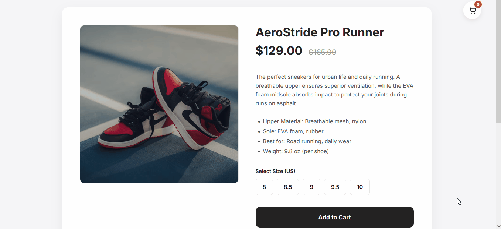

# ClarityCart AI | Embeddable product advisor

 

<p align="center">
  
</p>

## Problem & Value
ClarityCart AI reads product details from an e-commerce page and uses them to answer shoppers’ questions. This repository contains an earlier standalone demo, with the browser widget and its own Gemini endpoint. The [current project and widget source](https://github.com/agouti-ar/claritycart-landing) live in the main ClarityCart repository.

## Core Features
- **Vanilla JavaScript**: The browser widget has no runtime package dependencies.
- **Shadow DOM**: Isolates the widget's internal styles from the host page.
- **Product data extraction**: Reads JSON-LD, Open Graph metadata, and DOM elements.
- **Vercel function**: Keeps the Gemini API key on the server.
- **Gemini AI Integration**: Tries configured Gemini Flash models in order.
- **Automatic translation opt-out**: The widget sets `translate="no"`.

## Quick Start
The original demo can be loaded by including this script before the closing `</body>` tag on a test page:

```html
<script src="https://clarity-cart-widget.vercel.app/clarity.js" defer></script>
```

The widget will autonomously mount itself to the page, parse the product data, and be ready to assist your customers.

## Configuration
1. **API Key**: Set your `GEMINI_API_KEY` in your Vercel project environment variables.
2. **CORS**: Configure the storefront origin allowed to read browser responses from `api/chat.js`:
   ```javascript
   // Allow browser requests from the configured storefront origin.
   res.setHeader('Access-Control-Allow-Origin', 'https://yourstore.com');
   ```

Before exposing a production endpoint, add abuse protection and request limits. CORS controls browser access and does not authenticate direct requests.
